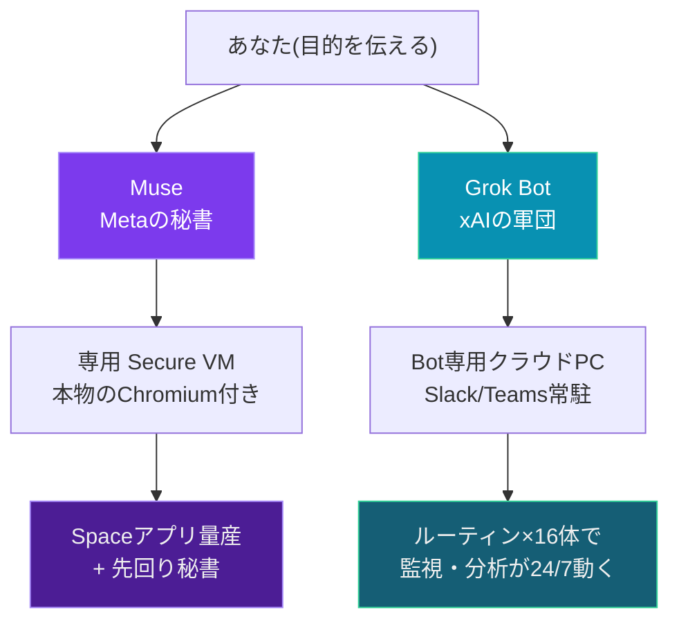
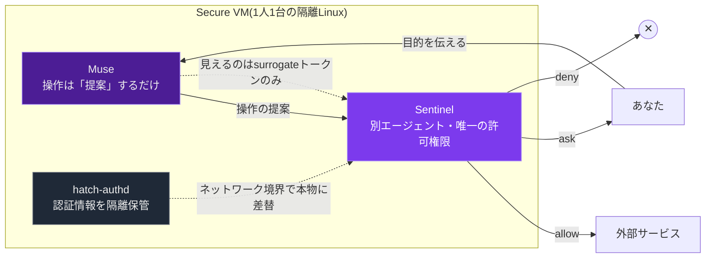
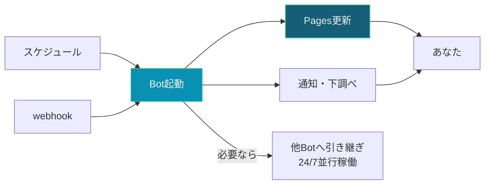
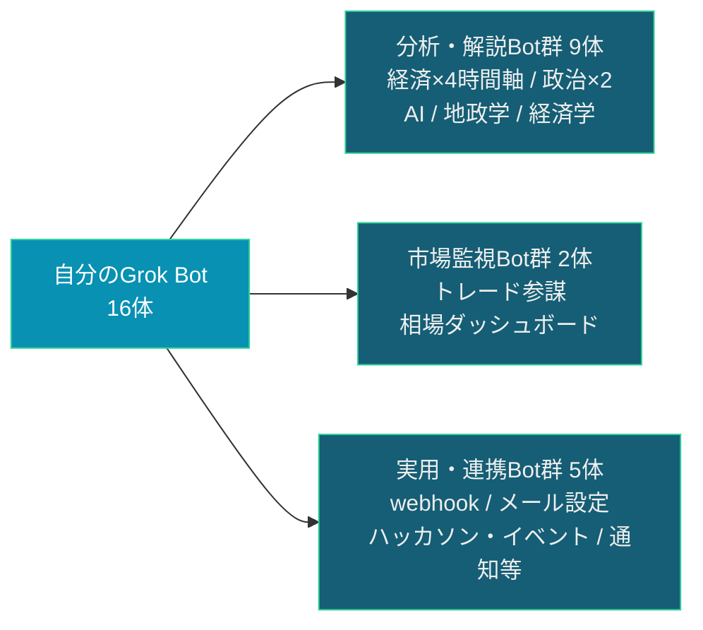
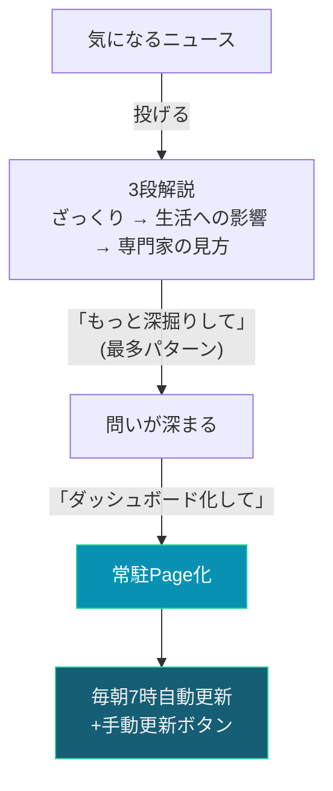
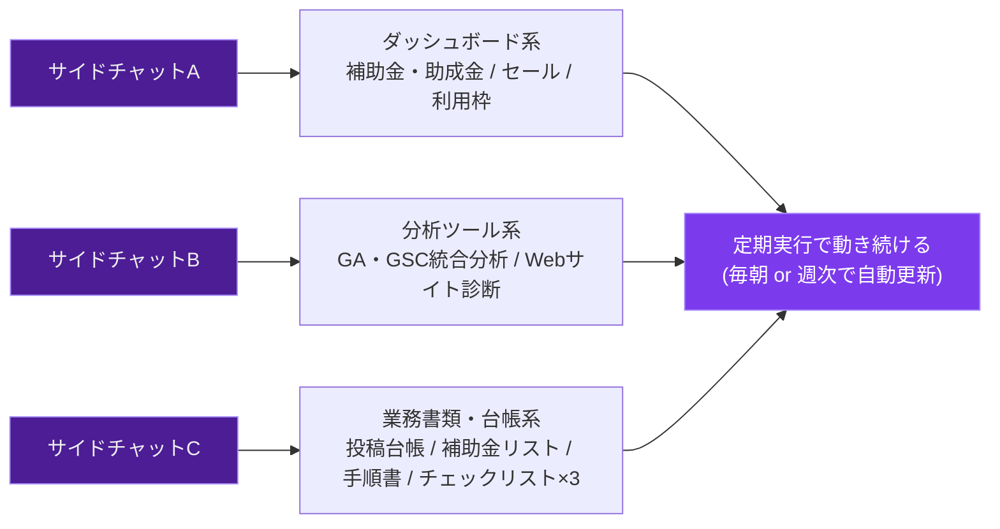

> この記事は 2026/11/19 のLT勉強会での発表資料の記事版です。
> スライド版: https://mori-tt.github.io/muse-grokbot/
> 発表者: [@morimoli_777](https://x.com/morimoli_777)

<!-- 公開時は published: true に変更してください -->

# はじめに

「AIに聞く」時代は終わりつつあります。2026年現在、Meta の **Muse** と xAI の **Grok Bot** という2つの「やってくれる」エージェントを実運用しています。

この記事では、

- 両者の基本と仕組み(公式一次情報で検証済み)
- 自分が実際にどう使っているか(ローカルの利用データから実測)

を全部公開します。

# まず結論: 「答える」AIから「やってくれる」AIへ

| | Muse | Grok Bot |
|---|---|---|
| 開発元 | Meta | xAI(基盤はCursor) |
| 中核モデル | Muse Spark(プロンプトインジェクション耐性はSOTA級と自称) | Grok |
| 単位 | メインMuse+サイドチャットで並列化 | 役割ごとのBot複数体 |
| エコシステムの強み | WhatsApp・音声 / Instagram・Facebook / Link決済 | X / Slack・Teams・会議 / GitHub系 |
| 主な接点 | iOS・Android・Web・Mac / WhatsApp / 音声 | デスクトップ・モバイル / Slack・Teams・X / 会議 |
| 実行環境 | 専用Secure VM(隔離Linux+本物のChromium) | Bot専用クラウドPC(転送・保存とも暗号化) |
| 自動化 | スケジュール+イベント駆動、Spaceアプリの定期更新 | ルーティン・webhook・常駐Pages |
| 安全の仕組み | Sentinel+認証情報の代替化+使い捨てカード | Auto Review / 権限継承 / Enterprise DLP |
| 料金 | 価格未公表(アカウント制) | Premium $30 / Super $100 / Ultra $200 + 従量 |

ざっくり言うと:

- **Muse = サイドチャットで分身もできる優秀な秘書**
- **Grok Bot = 雇って増やせる専門スタッフ軍団**

# 親会社の資産が、そのまま武器になる

「MuseはMeta系だからInstagram/WhatsAppに強い、Grok BotはX系だからXに強い」——この理解は方向性として正しいですが、実はもう一段あります。

## Muse = Meta直系

- **WhatsApp+音声モード**でも直接話せる(公式トップページ明記)
- **Instagram / Facebook** コネクタでMeta系アプリと連携
- 決済は Link(Stripe製)のワンタイムカード — カード番号を見せない
- 公開バグバウンティ **最大$300K**(プロンプトインジェクション攻撃だけで最大$130K)

## Grok Bot = xAI × Cursor

- 開発元は xAI(SpaceX Super Intelligence LLC) — **Xの投稿監視・収集が得意**。**X上でもBotとチャットできる**(公式docs「desktop, mobile, in Slack, or on X」)
- 実行基盤は **Cursor製**(ダウンロード元が `api2.cursor.sh`、MCP+skillsプラグイン対応)
- だから GitHub・webhook・git操作など **開発者ワークフローにも強い**

「X系だからXが強い」だけでなく、CursorのエンジニアリングDNAが入っているのがGrok Botの本質です。エージェント選びは「どの会社の資産に近い仕事か」で考えると外れません。

# Muse の中身を深掘り

公式デザインブログ([How We Designed Muse](https://muse.ai/blog/how-we-designed-muse))とセキュリティブログ([How We Built Safety Into Muse](https://muse.ai/blog/security-and-safety-for-ai-agents-our-approach-with-muse))から読み解きます。

## 基本設計

システムプロンプトの1行目は:

> Your purpose is to make your user's life better.

中核は専用モデル「**Muse Spark**」。ゼロショットのツール呼び出し、長コンテキスト、長軌道の指示追従、プロンプトインジェクション耐性、マルチエージェント連携を重点的に訓練されています。

会話はターン制ではなく、**1本の長い会話**。返答を待たずに次々タスクを投げられ、記憶は会話をまたいで持続します。別コンテキストで進めたい話題は **サイドチャット** へ——これは何本でも立てられるので、テーマ別に並列で量産できます。

## 4つの仕組み

### 専用 Secure VM

1人1台の永続・隔離Linuxマシン。ブラウザは**本物のChromium**で、自分がいつでも覗いて手を出せます。コードを書いてコンパイルし、道具やコネクタまで自作。認証情報はVM内の隔離領域に保管され、Metaの中央基盤には置かれません。

### Artifacts

テキストで返すより「モノ」を作る。家計トラッカー、学習ガイド、睡眠ダッシュボード——チャットに届き、そのまま使えます。

### Goals & Memory

Goalsタブで長期目標と計画を追跡。記憶ファイルは自分で閲覧・編集・ダウンロードできる透明設計です。

### バックグラウンド実行

アプリを閉じてもcronと**サブエージェントの群れ**が働き続けます。スケジュールとイベント駆動で進め、「意味のある変化がある時だけ」通知してきます(通知頻度は調整可能)。

## 安全設計(ここが一番すごい)

公式セキュリティブログの実装詳細が本当に攻めています。設計思想は「**エージェントは攻撃されている前提**」。

### Sentinel — 唯一の許可権限

Museは操作を「提案」するだけ。**コネクタ操作と全ネットワーク通信(L4/L7)の許可は、ホスト側の別エージェントSentinelが独占**します。許可は one-time/セッション/タスク/期間限定の厳格なcapabilityとして発行され、会話上の合意とは別物として管理されます。

### モデルは秘密を見ない(surrogateトークン)

エージェントが見るのはダミーの **surrogateトークンのみ**。通信が確定した後、Sentinelがネットワーク境界で本物の認証情報に差し替えます。

:::message
**ポイント**: プロンプトインジェクションでエージェントを騙しても、そもそも奪える秘密をエージェントが持っていない設計。「lethal trifecta」(非公開データ+信頼できない入力+外部送信の3条件)への構造的な対策です。
:::

さらにメールコネクタは、ワンタイムパスコード・パスワードリセットリンク・ログインマジックリンクまでフィルタしています(メールは全アカウントのリセット経路になりうるため)。

### tainted egress(eBPF)

カーネルレベルでデータフローを追跡。**ユーザーデータを読んだプロセスは「汚染」扱いで自動許可を失い**、外部送信は必ず承認フローへ。クリーンな処理だけがサイレントに通れる仕組みです。

### その他の多層防御

- 隔離は `systemd-nspawn`(セル内rootはホストの非特権ユーザーにマップ)
- PI検知はモデル学習+アンサンブル分類器の多層防御
- ブラウザはDOMではなく**アクセシビリティツリー**経由。JS実行不可、DevTools無効
- 使い捨てカードは**加盟店・金額・期限に紐付け**て発行。チェックアウト検知で毎回承認
- 「**Confidential VM**」(Meta社もアクセスできない暗号化モード)を2026年内提供予定と公表(ブログ時点)

# Grok Bot の中身を深掘り

[Introducing Grok Bot 1.0](https://x.ai/news/grok-bot-1-0)(2026/11/11)と [docs.x.ai](https://docs.x.ai) より。

## 1.0の3つの強化

### Multiplayer

Botをチームで共有。Slack/Teams常駐のほか、**Meet/Zoom/Teamsの会議に「〜transcribing」名で参加して議事録+アクション項目**を返します(会議機能はTeam/Enterprise/Ultraプランのみ、ホストの承認制)。

### Proactive

頼まれる前に動く。放置タスクのフォロー、次に必要なことの提案、判断が要る場面で人を呼びます。

### More capable

ブラウザ操作が高速・安定化。ドキュメント/スライド作成、共同編集できるインタラクティブなPagesを生成します。

## 動作モデル: ルーティンとPages

- **Routines**: 「毎朝7時にダッシュボード更新」のような定期実行。webhookトリガーでも起動可能
- **Pages**: ダッシュボードなどの常駐コンテンツ。Botが更新し続け、自分でも編集できる
- **見せれば覚える**: 「Show your Bot a workflow once.」手順を一度実演すれば記憶して再現
- **Bot同士で連携**: 複数Botが並行稼働し、必要に応じて他のBotへ引き継ぐ

## Botマーケットプレイス

[x.ai/bot/marketplace](https://x.ai/bot/marketplace) には公式+コミュニティ製のBotが並び、ワンクリックで追加できます。公式例としては Sales Outbound(深夜にパイプライン生成)、Talent Scout、Bug Reproduction、Account Health、Chief of Staff など。「X写真をGrok Bot風アイコンにするPfp Bot」のようなXネイティブなBotまであります。自分のBotも公開可能です。

# 自分の使い方①: Grok Bot(実測)

ローカルの利用データを分析した結果(2026/10/10〜11/18):

- **運用中のBot数: 16**
- Botとの総やり取り: **500+**
- ルーティン自動実行: **34回**
- 稼働中のwebhook連携: **1件**

※各Botには「日本語話者(Asia/Tokyo)、常に日本語で簡潔に」と共通ルールを持たせています。

## ニュースを「視点」で切り分ける分析軍団

経済・短期 / 経済・中期 / 経済・長期 / 経済・過去5年時系列 / マクロ・ミクロ経済学 / 政治分析 / 国際政治分析 / AI周りの重要ニュース / X通知 ——と、**同じニュースを複数の時間軸・領域で解説させる**使い方をしています。

こだわりの指示として、経済ニュースは**クルーグマン vs マンキュー**の対比で解説させたり、「数値は実際に取れたものだけ、出典と日本時間の時点を明記」とルール化したりしています。

## 最も作り込んだBot「トレード参謀」

Botと一緒に設計して作った、ルーティン+Pagesの複合監視システムです。

**常駐ルーティン(自動実行)**

- **寄り前チェック**: 平日8:15〜。夜間の米株・ドル円・金利・日経先物+監視アカウントの投稿から注目水準を3行で届ける
- **急変アラート**: 取引時間中1時間毎。急騰急落・日銀・介入系を検知した時だけ通知
- **週間カレンダー**: 日曜夜。翌週の指標・会合・決算と事前の見方

**自動更新されるPages**

- **相場ダッシュボード**: Xの強気/弱気センチメント推移、言及の多い支持線・抵抗線一覧(出典付き)、主要指標
- **トレード日記**: 売買記録ではなく、その日の相場観察・センチメントを蓄積して振り返るページ

監視対象はXの金融アカウント3つ+日経先物・ドル円・米3指数・VIX・米10年金利。**Xアクセスの強さをフル活用**しています。運用ルールは「止めて」「再開して」でルーティンを即停止/再開、投資助言ではない旨をページに明記する約束。

## チャットを超えて: Botを「開発基盤」にする

Cursor基盤だからこそできる、開発者向けの使い方:

- **自作アプリのAIバックエンド**: 開発中のNext.jsアプリ「DOWNTIME」からwebhookルーチン経由でBotを呼び出し、画像解析→診断JSON+画像生成→callback返却まで任せている
- **Bot内でアプリを作らせる**: 「Xの特定ワードが投稿されたら通知されるアプリ」をGrok Bot内に作らせて運用
- **雑務も丸投げ**: 「db更新、commit/pushしておいて」と開発の後片付けを依頼。Bot専用メールアドレスの発行も任せている

:::message
**ポイント**: webhookルーチンを使うと、Grok Botが「ログイン済みで道具を持った自分専用のAIエンドポイント」になります。Cursor由来の拡張性がここに効いています。
:::

# 自分の使い方②: Muse(実測)

## Spaceにアプリを量産している

サイドチャットを複数立ち上げて並行制作。ライブラリに**11個のスペース**がありました:

そして作るだけではありません。PDF出力の実装、複数サイト登録・比較機能の追加、バグチェック、HTTPS/リダイレクト監査まで**Museにそのまま改修させています**。

## メールを読み、先回りして知らせてくる

チャット履歴から見えた、プロアクティブ秘書としての実態:

- 講座の当日リマインド+事前登録の未読チェック
- **会食・待ち合わせ**も場所・時間・相手を整理して通知
- 入館に必要なゲストID/QRの有無を前日に確認
- **予定が重なったら「どちらを優先しますか?」と聞きに来る**
- クラウドDBの「プロジェクト凍結予告」通知を拾って期限を逆算して警告

驚きだったのは、Museが自分の手を超えない線引きも正直に言う点です(「Macは未接続なのでフォルダは触れません」と明言していた)。

# 使い分けと、上手な任せ方

- **Spaceアプリ・先回り秘書 → Muse**: ダッシュボード・診断・手順書をSpaceアプリとして残し、定期更新。メール監視でリマインドや期限警告まで届けてくれる個人領域
- **常駐・監視・仕組み化 → Grok Bot**: ルーティン・Pages・webhookで「動き続ける仕組み」を作れる。X情報の収集と開発まわりはこちらの独壇場

運用で効いた3つのルール:

1. 各Botに**専門と出し方のルールを最初に詰める**(解説フォーマット・出典明記・日本語固定)
2. 通知は**「役に立つときだけ」**に絞る。ノイズを増やすBotは信用を失う
3. 送信・購入・削除など**不可逆な操作は必ず承認制**、ログを定期的に眺めて任せ方を調整

# まとめ

質問に答えるAIの先には、自分の代わりに動き続ける仕組みがあります。

- **Muse**: Spaceアプリを量産する、先回りする個人秘書
- **Grok Bot**: 役割を与えて増やせる、24/7の専門スタッフ

小さく任せて、確かめて、広げる。まずは1体のBot・1つのSpaceアプリから試してみてください。

# 出典・参考リンク

この記事の製品仕様はすべて一次情報で確認しています。

**Muse(Meta)**

- [muse.ai](https://muse.ai) — 公式トップ
- [How We Designed Muse](https://muse.ai/blog/how-we-designed-muse) — 設計思想(Mona Sarantakos, 2026/9/8)
- [How We Built Safety Into Muse](https://muse.ai/blog/security-and-safety-for-ai-agents-our-approach-with-muse) — Sentinel/VM/eBPF実装(Tarek Sheasha)
- [Metaヘルプセンター](https://www.meta.com/help/superintelligence/1436362127544482/) — 購入フロー・承認の仕組み
- [Stripe newsroom](https://stripe.com/newsroom/news/stripe-helps-meta-muse-shop-with-link) — Link agent wallet発表(2026/9/8)

**Grok Bot(xAI)**

- [x.ai/bot](https://x.ai/bot) — 公式トップ・料金
- [Introducing Grok Bot 1.0](https://x.ai/news/grok-bot-1-0) — 1.0発表(2026/11/11)
- [docs.x.ai/grok-bot/meetings](https://docs.x.ai/grok-bot/meetings) — 会議参加の仕様
- [docs.x.ai/grok-bot/microsoft-teams](https://docs.x.ai/grok-bot/microsoft-teams) — Teams連携
- [x.ai/changelog/bot](https://x.ai/changelog/bot) — 機能更新履歴

※「自分の使い方」パートは実際のローカル利用データ・ログイン済み画面からの実測(2026/10〜11)です。
