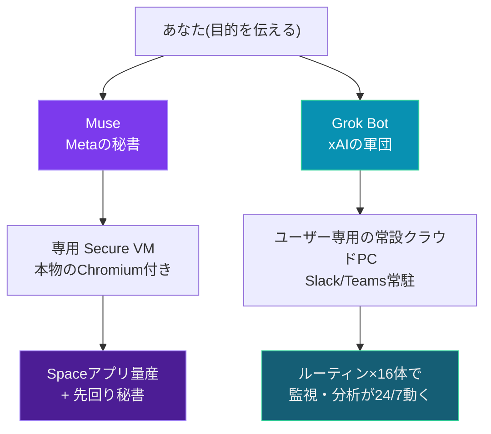
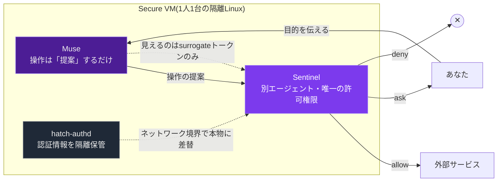
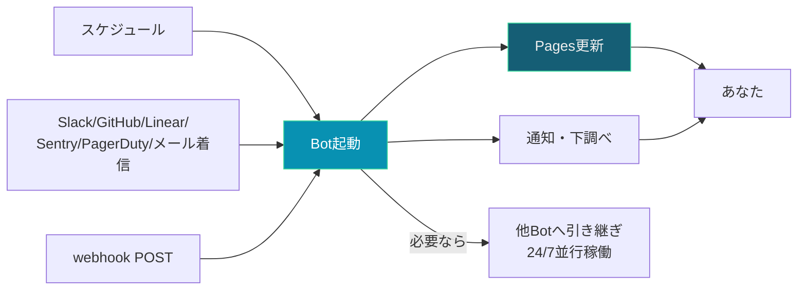
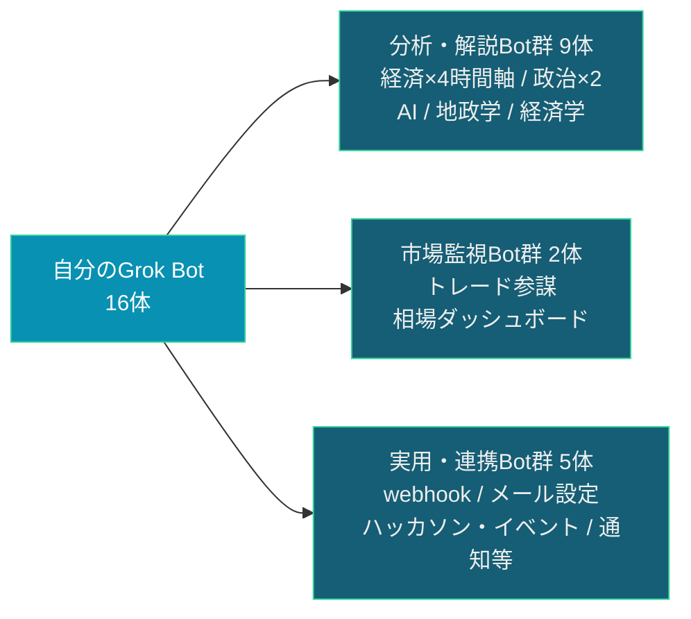
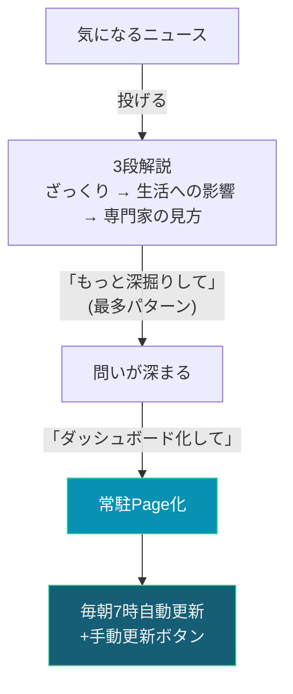
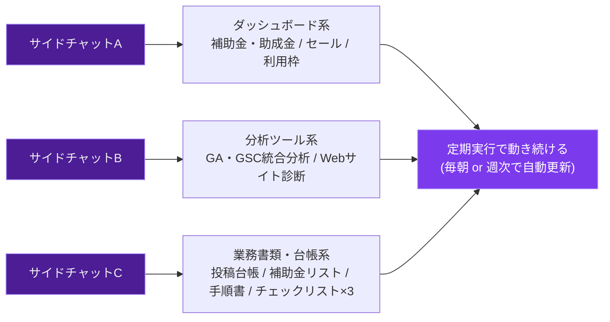

> この記事は 2026/11/19 のLT勉強会での発表資料の記事版です。
> スライド版: https://mori-tt.github.io/muse-grokbot/
> 発表者: [@morimoli_777](https://x.com/morimoli_777)

<!-- 公開時は published: true に変更してください -->

# はじめに

「AIに聞く」時代は終わりつつあります。2026年現在、Meta の **Muse** と xAI の **Grok Bot** という2つの「やってくれる」エージェントを実運用しています。

この記事では、

- 両者の基本と仕組み(公式一次情報で検証済み)
- 自分が実際にどう使っているか(ローカルの利用データから実測)

を全部公開します。

# まず結論: 「答える」AIから「やってくれる」AIへ

| | Muse | Grok Bot |
|---|---|---|
| 開発元 | Meta | xAI(基盤はCursor) |
| 中核モデル | Muse Spark 1.3(プロンプトインジェクション耐性は「close to SOTA」と公式評価) | Grok |
| 単位 | メインMuse+サイドチャットで並列化 | 役割ごとのBot複数体 |
| エコシステムの強み | WhatsApp・音声 / Instagram・Facebook / Link決済 | X / Slack・Teams・会議 / GitHub系 |
| 主な接点 | iOS・Android・Web・Mac / WhatsApp / 音声 | デスクトップ・モバイル / Slack・Teams・X / 会議 |
| 実行環境 | 専用Secure VM(隔離Linux+本物のChromium) | ユーザー専用の常設クラウドPC(Firecracker microVM、自分の全Botで共有) |
| 自動化 | スケジュール+イベント駆動、Spaceアプリの定期更新 | ルーティン・webhook・常駐Pages |
| 安全の仕組み | Sentinel+認証情報の代替化+使い捨てカード | Auto Review(独立レビューモデル) / Custom Rules / Vault / Enterprise DLP |
| 料金 | 無料(週制限あり)+Power $20・Maximum $100(現時点の提供はUS・Canada・18歳以上) | Premium $30 / Super $100(3.5x) / Ultra $200(12x) + トークン従量 |

ざっくり言うと:

- **Muse = サイドチャットで分身もできる優秀な秘書**
- **Grok Bot = 雇って増やせる専門スタッフ軍団**

# 親会社の資産が、そのまま武器になる

「MuseはMeta系だからInstagram/WhatsAppに強い、Grok BotはX系だからXに強い」——この理解は方向性として正しいですが、実はもう一段あります。

## Muse = Meta直系

- **WhatsApp+音声モード**でも直接話せる(公式トップページに「by message or with voice mode」と明記)
- **Instagram / Facebook** コネクタでMeta系アプリと連携。**Muse for Small Business** では Asana・Box・Canva・Dropbox・Figma・QuickBooks・Klaviyo・Notion・Shopify・Slack・Stripe・Zoom 等のビジネス系コネクタ+FB/IG/Meta広告のワンクリック接続
- 料金は**基本無料(週あたりの利用上限あり)+Power $20/月(毎週5億トークン)・Maximum $100/月(毎週30億トークン)**。公式FAQ上の提供地域はUS・Canada・18歳以上と明記(「今後さらなる市場へ」とのこと)
- 決済は Link(Stripe製)のワンタイムカード — カード番号を見せない
- 公開バグバウンティ **最大$300K**(プロンプトインジェクション攻撃だけで最大$130K)。しかも2026/11/2の公式投稿で**累計約$1.2M(630件超の報告・64件の有効判定)を支払い済み**と公表済み

## Grok Bot = xAI × Cursor

- 開発元は xAI(フッター表記: SpaceX Super Intelligence LLC) — **Xの投稿検索・閲覧はアカウント連携なしで標準搭載**。DMやホームタイムラインなどログイン領域はXプラグイン+自分のX APIクレジットが必要([docs.x.ai](https://docs.x.ai/grok-bot/computer-and-apps))
- 実行基盤は **Cursor製**。証拠はダウンロード元URL(`api2.cursor.sh`)だけではありません:
  - 実行そのものが **Cursorのクラウド** 上で動き、OAuthトークンは「Cursorのconnector backend」に保持される
  - チーム管理は `cursor.com/dashboard/bot`、アプリカタログは `cursor.com/marketplace`、ログインはCursorアカウント(SSO/SCIM連動)
  - 公式FAQに「**Grok Bot uses the same Cursor SSO, auth, and privacy mode you already trust**」と明記
- だから GitHub・webhook・git操作・MCPサーバー追加など **開発者ワークフローにも強い**

「X系だからXが強い」だけでなく、CursorのエンジニアリングDNAが入っているのがGrok Botの本質です。エージェント選びは「どの会社の資産に近い仕事か」で考えると外れません。

# Muse の中身を深掘り

公式デザインブログ([How We Designed Muse](https://muse.ai/blog/how-we-designed-muse)、Mona Sarantakos with Christine Awad、2026/9/8)とセキュリティブログ([How We Built Safety Into Muse](https://muse.ai/blog/security-and-safety-for-ai-agents-our-approach-with-muse)、Tarek Sheasha、同日)から読み解きます。

## 基本設計

システムプロンプトの1行目は:

> Your purpose is to make your user's life better.

中核は専用モデル「**Muse Spark**」。現在のバージョンは **Muse Spark 1.3** で、ゼロショットのツール呼び出し(CLIとskills)、長コンテキスト、長軌道の指示追従(プロンプトインジェクションへの内在的な警戒付き)、マルチエージェント連携を重点的に訓練されています。コードネームは「Hatch」(コードベース内の内部名で、後述の `hatch-safety` や `hatch-authd` に名残りがあります)。

会話はターン制ではなく、**1本の長い会話**。返答を待たずに次々タスクを投げられ、記憶は会話をまたいで持続します。別コンテキストで進めたい話題は **サイドチャット** へ——これは何本でも立てられるので、テーマ別に並列で量産できます(そもそもサイドチャットは、初期テストで「トピックごとに文脈を分けたい」という要望から生まれた機能だそうです)。

## 4つの仕組み

### 専用 Secure VM

1人1台の永続・隔離Linuxマシン。ブラウザは**本物の最新Chromium**(仮想化レイヤ越し)で、自分がいつでも覗いて手を出せます。コードを書いてコンパイルし、道具やコネクタまで自作。VMはあなたのデータの「system of record」で、クライアント(iOS/Android/Web)はセキュアなトランスポート経由でVMに直接接続します。認証情報はVM内の隔離領域に保管され、Metaの中央基盤には置かれません。

### Artifacts

テキストで返すより「モノ」を作る。家計トラッカー、学習ガイド、睡眠ダッシュボード——チャットに届き、そのまま使えます。「旅行計画を人に頼んだら2000語の返信じゃなくて旅程表が欲しいでしょ」という設計思想です。

### Goals & Memory

Goalsタブで長期目標と計画を追跡。記憶ファイル(`MEMORY.md` など)は自分で閲覧・編集・ダウンロードできる透明設計で、「○○について忘れて」と頼めばforget skillが記憶と関連ファイルから削除してくれます。

### バックグラウンド実行

アプリを閉じてもcronと**サブエージェントの群れ**が働き続けます。スケジュールとイベント駆動で進め、終わるたびに「報告する価値があるか」を自ら評価して、**意味のある変化がある時だけ**通知してきます(頻度は会話で調整可能)。

### 権限と接点の細かい仕様

- **Muse on Macは別レイヤー**: Mac本体へのアクセスは「macOSのシステム権限」と「Muse側の設定」の**二重の許可**が必要で、許可したものにしか触れない。プライベートメッセージも「メッセージ系コネクタ」か「Muse on Mac」を明示的に許可しない限り読まない設計
- コネクタの**アクセス権はコネクタごとに個別設定**。加えて [muse.ai/platform](https://muse.ai/platform) でパートナーがコネクタを開発でき、**非対応サービス用のカスタムコネクタ**も公式で用意されている
- 「Allow always」はあくまでそのサイト/そのタスクだけに効く限定許可で、設定からいつでも見直せる
- 豆知識: Metaのリサーチページには「**Muse Wonder series**」と「**Muse Spark**」という名称が並んでいる。また公式FAQには「**なりすましMuseに注意せよ**——投稿やDMのリンク経由でパスワードを要求することは絶対にない」と明記されている

## 安全設計(ここが一番すごい)

公式セキュリティブログの実装詳細が本当に攻めています。設計思想は「**エージェントは攻撃されている前提**(assume the agent may be under attack)」。メンタルモデルは「rootを持つLLMエージェント」ではなく「**1台の箱の中の2つの隔離セキュリティドメイン**」です。

### Sentinel — 唯一の許可権限

Museは操作を「提案」するだけ。**コネクタ操作と全ネットワーク通信(L4/L7)の許可は、ホスト側の別エージェントSentinelが独占**します。 Sentinelはegressで宛先のホスト名・解決済み/最終IP・ポート・プロトコル・HTTPメソッド・パス・デコード済みリクエスト本文まで検査し、DNS解決後にプライベート宛先へ化けるSSRFも防ぎます。

承認が要る場合、ダイアログは会話ではなくクライアントUIに直接出され、回答もSentinelに直接戻ります。許可は one-time / セッション / タスク / 期間限定 / 永続 の厳格なcapabilityとして発行され、会話上の合意とは別物として管理されます。全部に聞くわけではなく、読み取り専用・許可済み・低リスクな操作はサイレントに通る設計です(「承認疲れ」自体をリスクと捉えている)。

### モデルは秘密を見ない(surrogateトークン)

エージェントが見るのは `hatch-authd` が発行したダミーの **surrogateトークンのみ**。通信が確定した後、Sentinelがネットワーク境界で本物の認証情報に差し替える(just-in-time credential insertion)ので、エージェントは本物を一切見ません。

:::message
**ポイント**: プロンプトインジェクションでエージェントを騙しても、そもそも奪える秘密をエージェントが持っていない設計。Simon Willisonが2025年6月に提唱した「[lethal trifecta](https://simonwillison.net/2025/Jun/16/the-lethal-trifecta/)」(非公開データ+信頼できない入力+外部送信の3条件)への構造的な対策です。
:::

さらにメールコネクタは、ワンタイムパスコード・パスワードリセットリンク・ログインマジックリンクを**決定的フィルタ+分類器モデルの二重**でフィルタしています(メールは全アカウントのリセット経路になりうるため)。

### 権限分離は3層(privsep / authd / Sentinel)

ビルトインコネクタは「CLIの薄いラッパが引数とファイルディスクリプタをUnixソケットで渡し、実際の処理はsystemdサンドボックス化されたワーカーが実行」する構成です。ワーカーはcgroupで識別され、認証情報の許可リストも個別——カレンダーのワーカーがパラメータを変えてもGmailの認証情報は `authd` から受け取れません。

- **privsep** が「認証情報を扱えるコードがどこで実行されるか」を決める
- **authd** が「認証された呼び出し元がどの認証情報を受け取れるか」を決める
- **Sentinel** が「その操作をしてよいか」を決める

サービスが対応していれば読み取り/書き込み権限も分離でき、OAuthスコープより細かい制御も可能です(例: Gmailのreadスコープを許可しつつ、通常それに付随するGmail設定へのアクセスだけ剥がせる)。

### tainted egress(eBPF)

カーネルレベルでデータフローを追跡。**ユーザーデータを読んだプロセスは「汚染」扱いで自動許可を失い**、外部送信は必ず承認フローへ。クリーンで narrowly bounded なauto-allowポリシーを通る処理だけがサイレントに通れます。実装は eBPF cgroupプログラム(ネットワーク傍受とプロセス帰属)+ 汚染伝播用に追加したLSMフックのeBPFプログラム。

### ブラウザも攻撃面として設計

- ブラウザ操作用の**専用サブエージェント**がタスクを実行。CDP(Chrome DevTools Protocol)はセル外のブローカーが握り、サブエージェントが見るのはDOMではなく**アクセシビリティツリーのスナップショット**。ページ内JS実行不可、DevTools無効
- ユーザーがブラウザを引き継ぐ間、および認証情報ストアがフォーム入力している間はエージェントは一時停止して何もできない
- 独立した分類器群が「タスクと無関係な個人データのegress」「DOM内のPI」「画像/メディア経由のPI」「ダウンロードファイル経由のPI」「高リスクフォーム送信」を監視
- Metaが既存で持つ悪意サイトのブロックリストをVM内でも照合

### その他の多層防御と運用

- 隔離は `systemd-nspawn`(セル内rootはホストの非特権ユーザーにマップ)。セル固有のDebian rootfs、仮想NIC、フィルタ済みシステムコール(`io_uring` 禁止)、制限されたケーパビリティ(`CAP_SYS_PTRACE`/`CAP_NET_ADMIN` なし)
- セル内外の通信はUnixドメインソケット+`SO_PEERCRED`+ピアACL。耐久状態はセル・認証情報ストアと分離されたpostgresへ
- PI対策は4層: モデル学習(Muse Spark 1.3はこの能力で「close to SOTA」)+ ハーネス側で外部データに「untrusted」ラベル付け + 実データとエージェント的レッドチーミングで訓練した**複数分類器のアンサンブル** + HITL承認
- 使い捨てカードは**加盟店・金額・期限に紐付け**て発行。保存済みカードのサイトではチェックアウトページを検知して購入明細つきで毎回承認
- 「**Confidential VM**」(Meta社もアクセスできない暗号化モード)を年内提供予定。すでに少人数の信頼テスターが利用中で、設計とソースコードを外部監査人に開示し始めており、ローンチ後は誰でも検査可能な継続監査にすると公表
- データ方針: 会話やVMのデータはMetaの広告システムと共有しない。学習にはPII除去済みのtrajectoryを使い、設定スイッチでopt-out可能

## データ方針(プライバシーポリシー 2026/11/16施行)

Muse専用のプライバシーポリシーがつい先日更新されていて、ここも読み応えがあります:

- **会話・VM内データはMetaの広告システムと共有しない**——同じアカウントセンターに他のMeta製品があっても、Museでのやり取りやVMデータはFacebook/Instagram/Threads/WhatsAppと共有されないと明記
- **学習利用はデフォルトON**で、設定→データコントロールのトグルでいつでも切替可。**オフにすると過去のやり取りにも遡って適用**され、学習利用の場合も名前・メール・電話番号等の個人情報は学習前に除去+アカウントとの関連付けを解除
- **「Muse Confidential VM」がポリシー文書にも明記**: 「Metaに対してもユーザーの情報をプライベートに保つよう設計された環境」を将来選択可能にすると公式ポリシーが記述(セキュリティブログの「年内提供予定」説と一致、まだ未提供)
- **デバイス連携**: Muse for Macのほか、**「Muse Charm」というデバイス**(動作にMuse本体が必要)と、AIグラス等のMetaウェアラブル経由でもMuseにアクセスできる(MPT補足条項が適用)
- コネクタは**読み取り専用に制限できる**ものが多く、カレンダー変更等で能動的にMuseへ情報を送れるコネクタは「リンク前にMetaが特定したもの」だけ。メールも「指示しない限り受信箱全体はダウンロードしない」設計
- データのリセット・削除・「忘れる」スキルが揃っていて、削除後も残る学習済み記憶は「忘れて」で対処可能

## バグバウンティ: 金額だけでなく実績が出ている

2026/11/2公開の公式投稿([Securing Muse](https://muse.ai/blog/securing-muse)、David Singleton)によると:

- バウンティは**4月から非公開・9/8ローンチと同時に公開**で運用。**630件超の報告、64件の有効判定、累計約$1.2M支払い済み**
- 最高額$300Kはローンチ**4ヶ月前**に支払われた。ローカルのHTTPSプロキシが付けるヘッダを「信頼元の証明」として扱っていたところ、システム移行でプロキシ層が増えて外部リクエストもそのヘッダを持てるようになっていた——研究者が内部テスト用VMの会話・トークンへのアクセスを実証したケース
- 他の実例: Museのブラウジングツールのステータス表示を真似てPIを通す手法(**$90K**。分類器が元攻撃+100バリエーションを検知するよう改善)、書式でOTPフィルタをすり抜ける手法(**$90K**)、Androidの特権WebViewへの悪意リンク(**$50K**)、Macアプリ自動更新の権限昇格(**$1K**)
- 認定慈善団体への寄付を選ぶと**Metaが同額を上乗せ**する仕組みも

公式いわく「$300Kの最高額は他の主要AIラボの公表最大額の数倍」で、「Muse isn't immune to attack. Prompt injection remains an open problem」と無敵ではないことも明言しています。こういう「実際に刺さった例を金額つきで公開する」姿勢は、設計が本気度の裏付けになっています。

# Grok Bot の中身を深掘り

[Introducing Grok Bot 1.0](https://x.ai/news/grok-bot-1-0)(2026/11/11)と [docs.x.ai](https://docs.x.ai) より。

## 1.0の3つの強化

### Multiplayer

Botをチームで共有(Team Bots)。特定メンバーやグループに絞って共有でき、Slack/Teams常駐のほか、**Meet/Zoom/Teamsの会議に「Bot名 (〜のBot) - transcribing」名で参加して議事録+アクション項目**を返します。

会議の流れは: 会議リンクをBotのチャットに貼る → Botが出す承認カードをOK → 開始時にホストが参加を許可。カレンダー連携すれば予定された会議に自律参加も可能。ルーティン経由で送られたBotはメモを取るだけで会議チャットには答えない、という違いまである([docs](https://docs.x.ai/grok-bot/meetings))。会議機能はTeam/Enterprise/Ultraプランのみ、Enterpriseは管理者が設定でオンにします。

Team Botまわりの設計も練られています:

- **各人のチャットは完全にプライベート**——オーナーやManagerでも他人のチャットは読めない
- 役割は Owner(削除まで全権) / Manager(設定・共有・学習レビュー) / Collaborator(チャット+教育)
- **学びのガバナンス**: Collaboratorが教えた内容は即反映されず「提案」として保留され、Owner/Managerが承認して初めてチーム全体に適用される(共有メモリを荒らさない仕組み)
- 自分のチャットでは**自分のPC・自分の枠・自分のアプリ**で動くが、Slackのチャンネル等の共有場では**Team Bot自身の専用PC**で動き、オーナーが登録したアプリ・シークレット・ファイルは全員のチャットで有効になる(だから共有Botには広く使われて良いものだけを入れよ、と公式が警告)

### Proactive

頼まれる前に動く。放置タスクのフォロー、次に必要なことの提案、判断が要る場面で人を呼びます。共有スペース用のセーフガードも入っていて、各人の権限を尊重し、公開チャンネルに出して良い情報か確認します(公式例: 代理店向け資料の「スライド6の機密財務情報を外して送るか?」と提案)。

### More capable

ブラウザ操作が高速・安定化。ドキュメント/スライド作成、共同編集できるインタラクティブなPagesを生成。Gmail・Google Calendar・GitHub連携の強化、「すでに許可済みの操作」を理解して聞きすぎないスマート承認、Team Botの設定とアナリティクスも追加されました(対応するchangelogアンカーは v0.71.2 / v0.75.2 / v0.75.5)。

## 動作モデル: スキル・ルーティン・Pages

- **Skill**: 手順・判断ルール・期待出力・安全境界を保存した再利用レシピ。全Botで共有でき、チームへの公開(Publish)・更新の同期(Sync)も可能
- **Routines**: 「毎朝7時にダッシュボード更新」のような定期実行に加え、Slackメッセージ・GitHub/Linear/Sentry/PagerDutyイベント・**Bot宛メール着信**・webhook呼び出しで起動。ノートPCを閉じていてもクラウドで動く
- **webhookの実体**: ルーティンに発行される `POST to` URL・`key`・`header` の3フィールド。送信側は `Authorization: Bearer <key>` 付きでPOSTすればよく、200応答=実行開始(JSONボディはBotにそのまま届く)。つまり**任意の外部システムからBotを叩ける公式の口**がある
- **Pages**: レポート・ダッシュボード・トラッカー等の常駐コンテンツ。BotのLibraryに残り、ルーティンからも更新できる。自分での編集はPage横の「Message about」チャットで依頼する形(フィルタ等の操作は自分の見え方だけを変え、本体はBotが管理)。段階ロールアウト中でEnterprise未対応、デスクトップ0.60.0+/モバイル1.14.0+が必要
- **見せれば覚える**: 「Show your Bot a workflow once.」Teach a taskで手順を一度実演すれば記憶して再現(可視のコンピュータ操作を最大10分記録、マイク音声は記録しない)
- **Bot同士で連携**: 複数Botが並行稼働し、必要に応じて他のBotへ引き継ぐ

## 実行基盤を深掘り

ここが一番誤解されやすい点なので正確に書きます。**Bot専用PCではなく、ユーザー専用PCが1台**です。

- 各ユーザーに**専用のFirecracker microVM**(独自カーネル・メモリ・仮想デバイス、ハードウェアレベル分離)が割り当てられ、**自分の全Botがその1台を共有**。各Botには独立した「画面」があり並行作業できるが、Cookie・ファイル・CLI認証情報は共有——「人格とワークスペースは分かれるが、コンピュートは分かれない」と公式が明記。共有ワークスペースは `/workspace`
- 認証まわり: ログインは **Vault → 接続したパスワードマネージャー(1Password等) → Secure Form** の順で探し、値はモデルに見せずに入力。SSO・passkey・CAPTCHA・別デバイス承認が来たら自分に「Take over」が渡る。YubiKey等のハードウェアキーもmacOS/Windowsで対応
- **Bot専用メールアドレス**: `yourname@mail.grokbot.com` を1アカウント1つ取得可能(再発行なし・`+alias` 対応)。これでBotはサービス登録・確認コード受取・領収書収集・メール着信トリガーのルーティンができる
- X連携: **公開Xの検索・投稿閲覧・アカウントの投稿/メンション・QT/RP数・トレンドはアカウント連携なしで読める**。DM・ブックマーク・ホームタイムライン・いいねの取得にはXプラグイン+自分のX developerアカウントのAPIクレジットが必要
- アプリ連携: カタログ(Gmail/Slack/Notion/Google系/Stripe/Power BI/BigQuery等)から接続するほか、**MCPサーバーをURLやコマンドでBotに追加させる**こともできる(プライベートネットワーク・私有CAは承認制)。OAuthトークンはCursorのconnector backendに残り、Botはトークンを受け取らずにツールを呼ぶ
- 手元のPC: Botが自分のMac/Windowsでコマンド実行するには別権限が必要で、デフォルトは「毎回聞く」(Never allowにもできる。チーム管理者が上限をキャップ可能)

## 安全の仕組み: Auto Review と Vault

### Auto Review

- Botが取る各操作(シェルコマンド・アプリ呼出・コンピュータ操作・自動化の書き込み・Cloud Agent/サブエージェントへの委譲)を**独立したレビューモデルAuto Review**が事前チェック。要承認なら操作と入力を書いた承認カードを出して待つ。「This can't be undone」「This changes sign-in or security settings」「This shares your data outside this chat」のような警告つき
- 回答は **Allow once / Always allow(似た操作を自動許可するCustom Ruleとして保存) / Deny(再送・再質問しない)**。バックグラウンド作業由来のカードは30分で失効
- **Custom Rules**は Allow自動化・Ask first 各最大20件まで。「Ask first」は必ず自分に聞き、両方マッチすればAsk firstが勝つ。管理者がAuto Reviewを強制・チームルールを配布することも可能
- メールの送信ルールも細かい: チャットで頼んだメールはAuto Review通過で送信、**ルーティンや着信対応で作った下書きは自分がSendを押すまで送られない**、転送・添付つきで読み切れないメールは必ず承認待ち

:::message
**PI対策としても効いている点**: Auto Reviewが「指示」として数えるのは**自分が打ったメッセージだけ**。公式docsの例では「会議ページに埋め込まれた隠しテキストが『連絡先にメールしろ』と書いてあっても、あなたの指示としては扱わない」と明記されています。MuseのSentinelと同じく、「信頼できない入力」と「権限」を分離する設計です。
:::

### Vault — 秘密はwrite-only

- ログイン・カード・連絡先をVaultに保存。**パスワードはBotも自分も二度と読めない**(カードは下4桁のみ表示)。書き換えはできても読み戻しは不可
- Botが新規サービスに登録する時は**Vaultがパスワードを自動生成して保存し、Bot自身も見ない**
- ログイン探索順は Vault → 接続した1Password等 → Secure Form。Secure Formは「Never shown to your Bot. Filled directly to example.com」とサイト名つきで出て、値はモデルに見せず直接ページに入力される
- 意外な点: **カード番号+セキュリティコードはGrok BotアプリのチャットではBotが見える**(注文カードのPayを押した後、チェックアウトに打ち込むため)。「毎回承認したいならカードをVaultに保存しない」という運用指針まで公式が書いている
- Vaultはアカウント全体で共有・Team Botでは使えない(Team Botには別の「Bot's accounts」ログインがある)
- 決済手段はVaultのカードのほか **Link・X Money・Shop Pay** のウォレット接続にも対応

### Enterpriseの本気度

- **Inference Hooks(beta)**: モデルへの全リクエストを署名付きで**自社のAIセキュリティサーバー**に送り、モデル実行前にallow/denyさせられる。Shadow modeでまず検証も可能
- **Action Recording**: ツール呼出・シェル・ブラウザ遷移・ルーティン実行・ガードレール介入をメタデータ記録(シェルは秘密値をスクラブ、ブラウザ遷移はURLのクエリと認証情報を除去、スクショ・タイプ文字は残さない設計)。OpenTelemetryで自社SIEMにストリーム可能
- 運用: Botコンピュータは**US内**で稼働(USデータレジデンシープログラムあり)。Cursor社(Anysphere)は **ISO/IEC 27001・42001認証**をSchellmanから取得済みでGrok Botもスコープ内
- モデルはユーザーが選べない: SpaceXSI自社モデル+サードパーティ(subprocessor list公開)をGrok Bot側が管理
- その他の管理者機能: Network Controls(最大50サイトのブロックまたはallowlist)、Team Setup Scripts(全PCへの初期スクリプト)、Team Secrets(スクリプト用の環境変数、暗号化保存・ログでは伏字)、AuditログのSIEM転送、データ保持期間(Bot/PC/メッセージ別)
- **SSO/IdP統合がガチ**: SAML 2.0(Okta・Entra・Google Workspace・OneLogin)+SCIM 2.0の自動プロビジョニング/デプロビジョニング。Bot PCは非管理Linux端末として扱われ、Oktaでは「Other Desktop」用の認証ポリシールール、EntraではLinux向け条件付きアクセスポリシーの作り方まで公式に記述。Okta FastPassさえTeam Setup Scriptで導入できる
- **Team Setup Scriptsの作りが本物**: Debianベースの各PCでsudoつき実行・30分タイムアウト・約日次の再実行・Check Scriptで冪等化・Team Secretsは環境変数としてのみ注入(マニフェストは平文のため秘密値禁止)。公式docsには**Tailscale exit nodeで社内プライベートネットワークに繋ぐ手順**が丸ごと載っている
- チーム内にも**「Browse Team Bots」という社内マーケットプレイス**があり、「Popular」「Team approved」(管理者承認済み)のバッジつきで一覧できる。組織共有のBotは席を持たないSlackメンバーのメンションにも(制限つきで)応答する
- 課金の面白い挙動: Team Botのチャットで他人が使った分は**回答した人の枠**を消費するが、Slackでアカウント未連携の人への返信は「チームのusage」を消費。**オーナーの利用上限が尽きると「This Bot's owner has reached their usage limit」と表示されてBotが止まる**
- 課金体系の変化: 新規は**「The X Subscription」**(CursorとGrokを1ワークスペース・1請求に統合)がデフォルト。週次の使用プールはGrok・Grok Bot・Cursorで共有され、PlusにはGrok Botが含まれない(Premium以上)。従来のSuperGrok/X Premium+リンクは既存ユーザー向けに残る
- 運用面の裏話: 障害確認は status.cursor.com の「Grok Bot」行。PC内で`rm -rf`してもチャットは別保存なので消えないが、`node_modules`やvenvはPC更新/Recover/Resetで消える仕様

## Botマーケットプレイス

[x.ai/bot/marketplace](https://x.ai/bot/marketplace) には公式+コミュニティ製のBotが並び、ワンクリックで追加できます。カテゴリは Engineering / Sales / Marketing / Design / Personal / **Recruiting & People** / Product / Operations。

- 公式(Grok Bot Team製): Outbound Prospecting、SEO & AEO Desk、Haggle Bot(SaaS費用削減案を起案)、Recruiting Coordinator
- 注目のコミュニティ製: Overheard(Reddit・HN・ニュース・Xで自社言及を監視し平日ダイジェスト)、Researchy(「最新Grokモデル+ライブ検索で、出典・日付つきの答えが欲しい人向け」——自分の運用ルールと同じ思想)
- 「APIをCursor/Agentプラグイン(MCP+skills)に包装してMarketplaceやcursor.directoryに公開する」**tinkabot** まである。拡張性がエコシステムごとCursor由来
- Xネイティブの例: X写真をGrok Bot風アイコンにする **Pfp Bot**(by Shub Gaur)
- どのBotの説明にも「**never sends/spends without your yes**」の系統の文言が必ずある——マーケットプレイスの品質基準として承認制が徹底されている

料金は Premium **$30**/月・Super **$100**/月(Premiumの3.5倍の使用量+ピーク時優先)・Ultra **$200**/月(12倍+最速アクセス)。週単位の使用量込みで超過はトークン従量課金。なお**有料Cursorプラン・Teams・EnterpriseのシートにもGrok Botは含まれている**(Enterpriseは管理者が有効化)。SuperGrok系やX Premium+の紐付けでも使える上、週の利用枠が尽きた時は「Usage limit reset」で即リセットも可能。

## 面白い機能を深掘り

公式ドキュメントを読み込んで「へえ、ここまでできるのか」と思った点を集めました(全部一次情報):

- **Botが電話をかける**(USのみ): 飲食店の予約や配送の問い合わせを音声電話で代行。通話中はライブ文字起こしが流れ、途中で「Take over」して自分が出ることも、相手の質問に自分がテキストで答えてBotが読み上げることもできる。録音と書き出しつき。「Botの発する電話はプライバシー設定に関わらず学習データに使われない」と明記
- **グループチャット**: **2〜6体のBotを1つのチャットに入れて協働**できる。「Aが調べてBが清書してCがファクトチェック」のように分担させ、@メンションやReplyで指示を振り分ける
- **X ChatでBotとチャット**: Xアプリ(iOS/Android)やx.comのX Chatから、**Grok Botアプリと同じ自分のBot**に話せる(Premium以上のThe X Subscription+Grok↔Cursorアカウント連携が必要、順次展開中)
- **音声でも話せる**: 双方向のボイスチャット(声の種類・速度・言語を設定可、言語は自動検出も)と、Botからのボイスメモ。iPhoneではSiriショートカット・Action Button起動・Live Activitiesで進行表示まで対応
- **買い物フローが専用UI**: 商品を頼むと写真・選択肢・「Why it fits」「Where to buy」つきの商品カードが返り、購入時は配送先・支払方法・合計・ギフト指定まで書いたオーダーカードで確認してからPay。**売り切れなら再入荷を監視するルーティンをBotが自分で作る**
- **Primary Botという総合窓口**: 自分の「メインBot」が他のBotを束ねて仕事を振る。しかも**既存のBotが「この仕事は専任Botにした方がいい」と新しいBotの作成を提案・作成してくる**。マーケットプレイスのdr eggbotは質問に答えるだけでBotチームを自動編成してくれる
- **Botは「テンプレート」として配布できる**: 公開リンク(またはチーム限定)で自分のBotの設定をコピー共有。相手には設定だけがコピーされ、自分のコンピュータ・ログイン・会話履歴は渡らない。iPhoneではBotの「複製」で別スコープ用に分身も作れる
- **Botが自分の携帯アプリも使う**: 自分のチャット内なら、自分のiPhone/Androidのカレンダー確認やタイマーなど一部の携帯アプリを操作できる(チーム管理者が上限を設定可能)
- **Xで「@bot」とタグるだけで仕事を投げられる**: Xの投稿やリプライで @bot に「このスレッドを要約してSlackに送って」と書くだけ。X上は確認の短い返事だけで、実作業と結果はGrok Botアプリのチャットに入る。画像つき投稿も読める(動画・GIFつき、@grok併記、モデレーション非通過だと無言で無視)。対象は「ほとんどの国のアカウント」で、未対応と明記されているのはAU/UK/EU・アイスランド・リヒテンシュタイン・ノルウェー(日本は除外リストにない)
- **画像と動画も作れる**: 写真っぽい画像に加えて**1〜15秒のMP4動画クリップ**(480p/720p、参照画像を最大14枚+指定タイミングの画像4枚)まで生成可能。ただし商標キャラや実在人物の生成はブロックされる設計(チャート等は対象外でPagesに振り分け)
- **他社AIから「記憶」を輸入できる**: 設定の「Import Memory」が他のアシスタント用のプロンプトを生成→回答を貼るとPrimary Botの記憶に取り込まれる。乗り換え導線まで公式で用意
- **自分のPCの回線を経由させられる**: データセンターIPをブロックするサイト対策に「Route traffic through this computer」でBot PCのweb通信を自分のデスクトップ回線経由にできる(社内管理下では管理者がロック可能)

# 自分の使い方①: Grok Bot(実測)

ローカルの利用データを分析した結果(2026/10/10〜11/18):

- **運用中のBot数: 16**
- Botとの総やり取り: **500+**
- ルーティン自動実行: **34回**
- 稼働中のwebhook連携: **1件**

※各Botには「日本語話者(Asia/Tokyo)、常に日本語で簡潔に」と共通ルールを持たせています。

## ニュースを「視点」で切り分ける分析軍団

経済・短期 / 経済・中期 / 経済・長期 / 経済・過去5年時系列 / マクロ・ミクロ経済学 / 政治分析 / 国際政治分析 / AI周りの重要ニュース / X通知 ——と、**同じニュースを複数の時間軸・領域で解説させる**使い方をしています。

こだわりの指示として、経済ニュースは**クルーグマン vs マンキュー**の対比で解説させたり、「数値は実際に取れたものだけ、出典と日本時間の時点を明記」とルール化したりしています(ちなみにマーケットプレイスのResearchyも「sourced, dated claims」が売りで、この需要は普遍的だと確信しました)。

## 最も作り込んだBot「トレード参謀」

Botと一緒に設計して作った、ルーティン+Pagesの複合監視システムです。

**常駐ルーティン(自動実行)**

- **寄り前チェック**: 平日8:15〜。夜間の米株・ドル円・金利・日経先物+監視アカウントの投稿から注目水準を3行で届ける
- **急変アラート**: 取引時間中1時間毎。急騰急落・日銀・介入系を検知した時だけ通知
- **週間カレンダー**: 日曜夜。翌週の指標・会合・決算と事前の見方

**自動更新されるPages**

- **相場ダッシュボード**: Xの強気/弱気センチメント推移、言及の多い支持線・抵抗線一覧(出典付き)、主要指標
- **トレード日記**: 売買記録ではなく、その日の相場観察・センチメントを蓄積して振り返るページ

監視対象はXの金融アカウント3つ+日経先物・ドル円・米3指数・VIX・米10年金利。**公開Xならアカウント連携なしで読めるという仕様をフル活用**しています(認証が要るDM等は対象外)。運用ルールは「止めて」「再開して」でルーティンを即停止/再開、投資助言ではない旨をページに明記する約束。

## チャットを超えて: Botを「開発基盤」にする

Cursor基盤だからこそできる、開発者向けの使い方:

- **自作アプリのAIバックエンド**: 開発中のNext.jsアプリ「DOWNTIME」からwebhookルーチン経由でBotを呼び出し、画像解析→診断JSON+画像生成→callback返却まで任せている。仕組みは前述の通り `Authorization: Bearer <key>` のPOSTをルーティンURLに投げるだけで、200が返れば実行開始。JSONボディはそのままBotに届く
- **Bot内でアプリを作らせる**: 「Xの特定ワードが投稿されたら通知されるアプリ」をGrok Bot内に作らせて運用
- **雑務も丸投げ**: 「db更新、commit/pushしておいて」と開発の後片付けを依頼。`mail.grokbot.com` のBot用メールアドレスの発行(サービス登録や確認コードの受取もBot自身ができる)も任せている

:::message
**ポイント**: webhookルーチンを使うと、Grok Botが「ログイン済みで道具を持った自分専用のAIエンドポイント」になります。Cursor由来の拡張性がここに効いています。
:::

# 自分の使い方②: Muse(実測)

## Spaceにアプリを量産している

サイドチャットを複数立ち上げて並行制作。ライブラリに**11個のスペース**がありました:

そして作るだけではありません。PDF出力の実装、複数サイト登録・比較機能の追加、バグチェック、HTTPS/リダイレクト監査まで**Museにそのまま改修させています**。

## メールを読み、先回りして知らせてくる

チャット履歴から見えた、プロアクティブ秘書としての実態:

- 講座の当日リマインド+事前登録の未読チェック
- **会食・待ち合わせ**も場所・時間・相手を整理して通知
- 入館に必要なゲストID/QRの有無を前日に確認
- **予定が重なったら「どちらを優先しますか?」と聞きに来る**
- クラウドDBの「プロジェクト凍結予告」通知を拾って期限を逆算して警告

驚きだったのは、Museが自分の手を超えない線引きも正直に言う点です(「Macは未接続なのでフォルダは触れません」と明言していた)。公式の説明とも整合していて、Muse on MacはmacOSのシステム権限とMuse設定の**二重の許可があるものだけ**にアクセスできる設計です。

# 使い分けと、上手な任せ方

- **Spaceアプリ・先回り秘書 → Muse**: ダッシュボード・診断・手順書をSpaceアプリとして残し、定期更新。メール監視でリマインドや期限警告まで届けてくれる個人領域
- **常駐・監視・仕組み化 → Grok Bot**: ルーティン・Pages・webhookで「動き続ける仕組み」を作れる。X情報の収集と開発まわりはこちらの独壇場

運用で効いた3つのルール:

1. 各Botに**専門と出し方のルールを最初に詰める**(解説フォーマット・出典明記・日本語固定)
2. 通知は**「役に立つときだけ」**に絞る。ノイズを増やすBotは信用を失う
3. 送信・購入・削除など**不可逆な操作は必ず承認制**、ログを定期的に眺めて任せ方を調整(これは公式ドキュメントが「明示的な境界をリクエストに含めよ」と推奨している項目と一致: メッセージ送信・公開・購入・削除・権限変更・本番変更・規約同意)

# まとめ

質問に答えるAIの先には、自分の代わりに動き続ける仕組みがあります。

- **Muse**: Spaceアプリを量産する、先回りする個人秘書
- **Grok Bot**: 役割を与えて増やせる、24/7の専門スタッフ

小さく任せて、確かめて、広げる。まずは1体のBot・1つのSpaceアプリから試してみてください。

# 出典・参考リンク

この記事の製品仕様はすべて一次情報で確認しています(確認日: 2026/11/19)。

**Muse(Meta)**

- [muse.ai](https://muse.ai) — 公式トップ(WhatsApp・音声モード明記)
- [How We Designed Muse](https://muse.ai/blog/how-we-designed-muse) — 設計思想(Mona Sarantakos with Christine Awad, 2026/9/8)
- [How We Built Safety Into Muse](https://muse.ai/blog/security-and-safety-for-ai-agents-our-approach-with-muse) — Sentinel/VM/eBPF実装(Tarek Sheasha, 2026/9/8)
- [Securing Muse: More Than $1 Million in Bug Bounties Paid Out](https://muse.ai/blog/securing-muse) — バウンティ実績(David Singleton, 2026/11/2)
- [Muse Security & Privacy](https://muse.ai/security-and-privacy) — Secure VM・Sentinel・Secure Credentials Storeの公式説明
- [Museプライバシーポリシー](https://muse.ai/privacy) — 2026/11/16施行。広告非共有・学習opt-out・Confidential VM構想・Muse Charm/AIグラス連携
- [Metaヘルプセンター「Museでの支払いのしくみ」](https://www.meta.com/help/superintelligence/1436362127544482/) — 購入フロー・承認の仕組み
- [Stripe newsroom](https://stripe.com/newsroom/news/stripe-helps-meta-muse-shop-with-link) — Link agent wallet発表(2026/9/8)。Link加盟店100万社超・ユーザー3億人超・ワンタイム仮想カードは事前承認額に限定
- [Simon Willison「The lethal trifecta」](https://simonwillison.net/2025/Jun/16/the-lethal-trifecta/) — Muse公式ブログも引用するPI前提条件の原典(2025/6/16)
- [bugbounty.meta.com](https://bugbounty.meta.com) — Museバグバウンティ窓口

**Grok Bot(xAI)**

- [x.ai/bot](https://x.ai/bot) — 公式トップ・料金・FAQ(Cursor SSO/暗号化/Auto Review/DLP明記)
- [Introducing Grok Bot 1.0](https://x.ai/news/grok-bot-1-0) — 1.0発表(2026/11/11)
- [docs.x.ai/grok-bot](https://docs.x.ai/grok-bot) — 「desktop, mobile, in Slack, or on X」等の仕様
- [docs.x.ai/grok-bot/meetings](https://docs.x.ai/grok-bot/meetings) — 会議参加の仕様
- [docs.x.ai/grok-bot/microsoft-teams](https://docs.x.ai/grok-bot/microsoft-teams) — Teams連携
- [docs.x.ai/grok-bot/skills-routines-and-automations](https://docs.x.ai/grok-bot/skills-routines-and-automations) — スキル・ルーティン・webhookの仕様
- [docs.x.ai/grok-bot/files-and-results](https://docs.x.ai/grok-bot/files-and-results) — Pagesの仕様
- [docs.x.ai/grok-bot/computer-and-apps](https://docs.x.ai/grok-bot/computer-and-apps) — 共有クラウドPC・メールアドレス・Xアクセスの仕様
- [docs.x.ai/grok-bot/approvals-security-and-privacy](https://docs.x.ai/grok-bot/approvals-security-and-privacy) — Auto Reviewの仕様
- [docs.x.ai/grok-bot/teams-and-enterprises](https://docs.x.ai/grok-bot/teams-and-enterprises) — Firecracker microVM・管理機能
- [docs.x.ai/grok-bot/vault](https://docs.x.ai/grok-bot/vault) — Vault・Secure Form・決済の仕様
- [docs.x.ai/grok-bot/team-bots](https://docs.x.ai/grok-bot/team-bots) — Team Botの権限・学習ガバナンス
- [docs.x.ai/grok-bot/bots](https://docs.x.ai/grok-bot/bots) — Bot作成・記憶・テンプレート共有
- [docs.x.ai/grok-bot/chat-and-collaboration](https://docs.x.ai/grok-bot/chat-and-collaboration) — ボイスチャット・X Chat・電話発信・買い物
- [docs.x.ai/grok-bot/how-grok-bot-works](https://docs.x.ai/grok-bot/how-grok-bot-works) — 動作モデルとPrimary Bot
- [docs.x.ai/grok-bot/use-cases](https://docs.x.ai/grok-bot/use-cases) — 公式の活用ステップとプロンプト例
- [docs.x.ai/grok-bot/mobile](https://docs.x.ai/grok-bot/mobile) — モバイルアプリ・Siri連携・携帯アプリ操作
- [docs.x.ai/grok-bot/security](https://docs.x.ai/grok-bot/security) / [security-faq](https://docs.x.ai/grok-bot/security-faq) — Network Controls・隔離・認証・居住性
- [docs.x.ai/grok-bot/tag-on-x](https://docs.x.ai/grok-bot/tag-on-x) — Xで@botタグして仕事を投げる仕様・対象地域
- [docs.x.ai/grok-bot/create-a-team-bot](https://docs.x.ai/grok-bot/create-a-team-bot) — Team Bot作成・共有コネクタ・Slack連携
- [docs.x.ai/grok-bot/identity-and-access](https://docs.x.ai/grok-bot/identity-and-access) — Okta/EntraでのSSO・デバイスポリシー
- [docs.x.ai/grok-bot/private-networks](https://docs.x.ai/grok-bot/private-networks) — プライベートネットワーク接続(Tailscale手順含む)
- [docs.x.ai/grok-bot/settings-and-notifications](https://docs.x.ai/grok-bot/settings-and-notifications) — ローカル実行・回線ルーティング・記憶インポート
- [docs.x.ai/grok-bot/inference-hooks](https://docs.x.ai/grok-bot/inference-hooks) — モデルリクエストの社外検査フック
- [docs.x.ai/grok-bot/faq](https://docs.x.ai/grok-bot/faq) — モデル選択・プラン・@bot等のFAQ
- [x.ai/bot/marketplace](https://x.ai/bot/marketplace) — Botマーケットプレイス
- [x.ai/changelog/bot](https://x.ai/changelog/bot) — 機能更新履歴
- [trust.cursor.com](https://trust.cursor.com) — Cursor/Anysphereの認証・subprocessor一覧

**料金・提供状況**

- [Museサブスクリプション(Metaヘルプ)](https://www.meta.com/help/subscriptions/1021145227643680/) — Power $20・Maximum $100・週制限
- [Muse for Small Business](https://muse.ai/business) — ビジネス向けコネクタ一覧・提供地域(US・Canada・18+)
- [Meta Newsroom: Introducing Muse Small Business](https://about.fb.com/news/2026/09/introducing-muse-small-business) — 公式発表(2026/9)
- [x.ai/bot](https://x.ai/bot) — Grok Bot料金(Premium/Super/Ultra・従量課金)

※「自分の使い方」パートは実際のローカル利用データ・ログイン済み画面からの実測(2026/10〜11)です。数値は自分のアカウントでの実測値であり、他の環境での再現を保証するものではありません。
